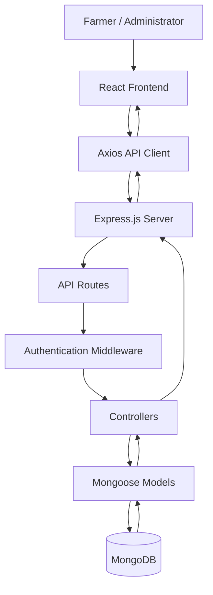
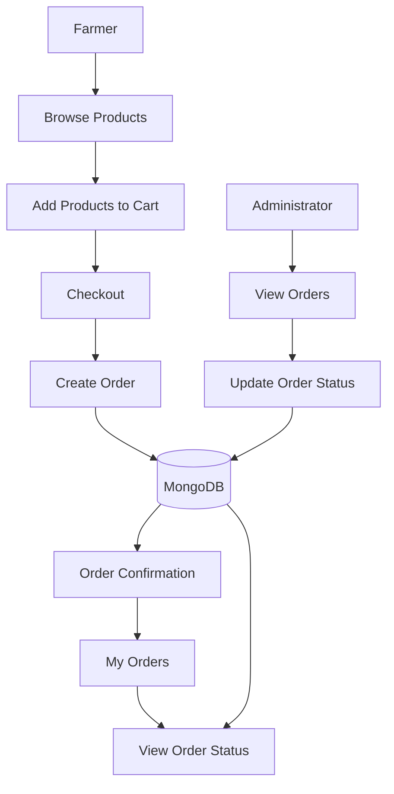

# AgriTech — Empowering Farmers Through Digital Technology

AgriTech is a full-stack web application developed to bring farming-related services and farm management tools together in one place. The project allows farmers to manage farm information, maintain crop records, explore agricultural products, and place and track orders.

I built this project using the MERN stack (MongoDB, Express.js, React, and Node.js). While developing it, I worked on both the frontend and backend, including authentication, API integration, database operations, and the connection between different application modules.

## About the Project

Managing a farm involves keeping track of several things, such as farm details, crop growth, weather information, and agricultural supplies. AgriTech provides a single web interface for accessing these features.

The application has separate functionality for farmers and administrators. Farmers can use the available farm management tools and shopping features, while administrators can manage users and handle orders.

The project is designed as a practical full-stack application that can be extended with additional agricultural features in the future.

## Features

### 1. User Authentication

- Farmer registration and login.
- Password hashing using bcryptjs.
- JWT-based authentication.
- Protected API routes.
- Authenticated requests from the frontend using Axios.

The frontend uses the `agritech_token` key for its authentication token. The Axios client is configured to use the backend API URL and handle unauthorized responses.

### 2. Farm Management

Farmers can manage their farm-related information through the application. The farm management module provides a place to maintain farm records and use them with other farm-related features.

### 3. Crop Monitoring

The crop monitoring module allows farmers to maintain records of their crops.

Crop records include information such as:

- Farm selection.
- Crop name.
- Planting date.
- Growth stage.
- Crop health status.
- Soil-related values, including pH, moisture, nitrogen, phosphorus, and potassium.
- Additional notes.

Users can add crop records, view existing records, update information, and delete records. The interface also provides a way to review crop information.

Soil-related values are entered manually in this version; they are not generated by an automatic soil-testing model.

### 4. Weather Information

The application includes a weather-related feature intended to help farmers access weather information.

Weather information can be useful when planning farm activities. The accuracy and availability of this information depend on the configured weather service and its connectivity.

### 5. Agricultural Products

The products page retrieves product data from the backend and displays the available products.

The page includes:

- Product listing.
- Search functionality.
- Category filtering.
- Prices displayed in Indian rupees.
- Product images and fallback images.
- Loading, error, and empty states.

This helps users browse the agricultural products available in the application.

### 6. Shopping Cart and Checkout

Farmers can select products, manage their cart, review quantities and prices, and proceed to checkout.

When an order is placed, the backend processes the order request and stores the order details in MongoDB.

### 7. My Orders

The My Orders page allows a logged-in farmer to retrieve and view their own orders.

The order information includes the selected products, quantities, prices, total amount, and order status.

### 8. Order Confirmation

After placing an order, the application provides an order confirmation page showing the relevant order information.

This helps the farmer verify that the order was recorded.

### 9. Admin Order Management

The administrator can retrieve orders and update their status.

The order statuses supported by the order model are:

- Pending
- Confirmed
- Shipped
- Delivered
- Cancelled

When an administrator updates an order status, the updated information can be viewed by the farmer in the order section.

### 10. Admin User Management

The application includes an administrative user management module for handling user-related operations.

Administrator-only operations should be protected by authentication and authorization middleware.

### 11. Dashboard

The application includes a dashboard that provides access to the relevant features of the platform.

The dashboard is part of the main application workflow and connects users to the available modules.

## Technology Stack

| Technology | Purpose |
|---|---|
| React | Building the frontend interface |
| Vite | Frontend development and build tooling |
| Bootstrap | Styling and responsive layouts |
| Axios | Communication with backend APIs |
| Node.js | Running the backend JavaScript application |
| Express.js | Backend server and REST API routes |
| MongoDB | Storing application data |
| Mongoose | Database models and MongoDB operations |
| bcryptjs | Password hashing |
| JSON Web Token | Authentication |
| Postman | Testing API requests |
| MongoDB Compass | Viewing and managing database records |
| Git and GitHub | Version control and source code hosting |

## Project Architecture

AgriTech uses a client-server architecture. The React frontend communicates with the Express backend through HTTP requests. The backend handles application logic, authentication, and database operations.



Authentication and authorization checks are applied to protected operations. Public and protected routes can follow different request flows depending on the endpoint.

## Project Folder Structure

The project is organized into two main applications: the frontend and the backend.

```text
AgriTech/
│
├── client/
│   ├── public/
│   ├── src/
│   │   ├── api/
│   │   │   └── axios.js
│   │   ├── pages/
│   │   │   ├── Products.jsx
│   │   │   └── ...
│   │   ├── App.jsx
│   │   └── ...
│   ├── package.json
│   └── vite.config.js
│
├── server/
│   ├── src/
│   │   ├── config/
│   │   │   └── db.js
│   │   ├── controllers/
│   │   │   └── ...
│   │   ├── middleware/
│   │   │   └── authMiddleware.js
│   │   ├── models/
│   │   │   └── ...
│   │   ├── routes/
│   │   │   └── ...
│   │   └── server.js
│   └── package.json
│
├── .gitignore
└── README.md
```

The `client` folder contains the React application, while the `server` folder contains the API, database configuration, models, routes, controllers, and middleware.

## Backend API Overview

The backend uses the `/api` prefix for its API routes.

| Route | Purpose |
|---|---|
| `GET /api/health` | Checks whether the backend is running |
| `/api/auth` | Registration and login |
| `/api/users` | User-related operations |
| `/api/farms` | Farm management |
| `/api/crop-monitoring` | Crop record management |
| `/api/dashboard` | Dashboard functionality |
| `/api/products` | Agricultural product operations |
| `/api/orders` | Order creation and farmer order operations |
| `/api/admin` | Administrative operations |

### Order API

The following order endpoints are implemented:

| Method | Endpoint | Purpose |
|---|---|---|
| POST | `/api/orders` | Create an order |
| GET | `/api/orders/my-orders` | Retrieve the logged-in farmer's orders |
| GET | `/api/orders/:id` | Retrieve a specific order |
| GET | `/api/admin/orders` | Retrieve orders for administration |
| PATCH | `/api/admin/orders/:id/status` | Update an order's status |

Protected order routes require authentication. Administrative routes should additionally verify administrator permissions.

## Database Design

MongoDB is used to store application records. Mongoose provides the models used by the backend to interact with the database.

The main data areas include:

**Users:** Account information and authentication-related data.

**Farms:** Farm records maintained through the farm management module.

**Crop monitoring records:** Crop details, planting dates, growth stages, health status, manually entered soil values, and notes.

**Products:** Product information used by the product listing and ordering features.

**Orders:** The user associated with an order, selected items, quantities, prices, shipping information, total amount, order status, and payment-related fields.

The order model includes a reference to the user and product references for the items in an order. It also supports a Cash on Delivery payment method and a payment status field.

### General Order Flow



## Authentication and Security

AgriTech uses JWT-based authentication to protect operations that require a logged-in user.

The registration process validates the submitted information and stores a hashed password. During login, the backend checks the submitted credentials and issues a token when authentication succeeds.

The authentication middleware verifies the bearer token and makes the decoded authentication information available to protected routes.

The frontend Axios client uses the configured API URL, attaches authentication information for protected requests, and handles unauthorized responses by clearing the local authentication session.

Administrative operations must also check the user's role or permissions. Authentication by itself should not allow an ordinary farmer to perform administrator actions.

## Environment Configuration

The backend uses environment-based configuration. The server uses `PORT` with a default of `8000`, and its CORS configuration uses `CLIENT_URL`, which defaults to `http://localhost:5173`.

The frontend API client uses `VITE_API_URL` and falls back to:

```text
http://localhost:8000/api
```

Create the required environment files using the exact variable names expected by the database configuration and authentication code.

Example frontend configuration:

```env
VITE_API_URL=http://localhost:8000/api
```

The database connection string and JWT secret should be configured according to the backend code. Do not put real secrets in the README or commit them to GitHub.

## How to Run the Project Locally

### Prerequisites

Install the following before running the application:

- Node.js and npm.
- MongoDB, configured for the connection method used by the project.
- A code editor such as Visual Studio Code.
- A modern web browser.

### 1. Get the Project

Clone the GitHub repository:

```bash
git clone YOUR_GITHUB_REPOSITORY_URL
cd AgriTech
```

Replace the placeholder with the actual repository URL.

### 2. Install Backend Dependencies

Open a terminal:

```bash
cd server
npm install
```

Configure the backend environment variables required by the project.

### 3. Start the Backend

Use the development command defined in `server/package.json`. If the script is named `dev`, run:

```bash
npm run dev
```

The backend should connect to MongoDB and start listening on its configured port.

You can check the health endpoint in a browser or API client:

```text
http://localhost:8000/api/health
```

### 4. Install Frontend Dependencies

Open a second terminal from the project root:

```bash
cd client
npm install
```

### 5. Start the Frontend

```bash
npm run dev
```

Vite will display the local frontend URL. Open that URL in your browser to use the application.

## Testing and Verification

Postman can be used to test backend endpoints independently of the frontend. MongoDB Compass can be used to inspect stored records.

Important workflows to test include:

1. Register a new farmer account.
2. Log in with valid credentials.
3. Confirm that invalid credentials are rejected.
4. Add and manage farm information.
5. Create, view, update, and delete crop records.
6. Browse products and use the search and category filters.
7. Add products to the cart and place an order.
8. Check the order confirmation and My Orders pages.
9. Update an order status through the administrator interface.
10. Verify that the farmer sees the updated status.
11. Confirm that protected operations reject unauthorized requests.
12. Check that the backend health endpoint responds successfully.

These checks cover the major workflows developed for the application.

## Limitations

The current version focuses on farm record management and the main shopping and ordering workflow.

- Soil-related values are entered manually.
- Automatic soil testing is not included.
- AI-based crop disease detection is not implemented.
- AI-generated crop recommendations are not included.
- Weather functionality depends on its configured data source.
- Production deployment requires further security, reliability, and performance testing.

## Future Improvements

The following ideas could be considered for future versions:

- AI-based crop disease detection from images.
- More detailed soil analysis and crop recommendations.
- Pest alerts and crop protection guidance.
- Weather-based farming recommendations.
- Support for Hindi and other regional languages.
- Voice-assisted access for farmers.
- Agricultural market prices.
- Notifications for order updates and crop activities.
- Online payment integration.
- More detailed reports and dashboard analytics.
- Automated testing and deployment.

These are possible improvements and should not be considered part of the current implementation unless they are developed and tested.

## What I Learned

Developing AgriTech gave me practical experience in full-stack web development.

I worked on building React pages, connecting them to backend APIs using Axios, creating Express routes, handling authentication, defining MongoDB models, and managing application data.

Working on products, checkout, and order management also helped me understand how multiple frontend and backend components work together to complete a user workflow.

The project gave me experience testing APIs with Postman, inspecting database records using MongoDB Compass, and organizing code into separate frontend and backend modules.

## Conclusion

AgriTech brings farm management, crop monitoring, weather information, and agricultural product ordering together in one web application.

The project helped me apply the MERN stack to a practical use case and understand how authentication, APIs, database models, and frontend pages connect in a full-stack application.

It provides a foundation for adding more agricultural features and improving the experience for farmers in future versions.

## Author

**Usman Gani Ansari**

B.Tech — Computer Science Engineering  
Medicaps University

## Repository

**GitHub:** https://github.com/usman313gani-crypto/AgriTech.git

---

*AgriTech — Empowering Farmers Through Digital Technology*